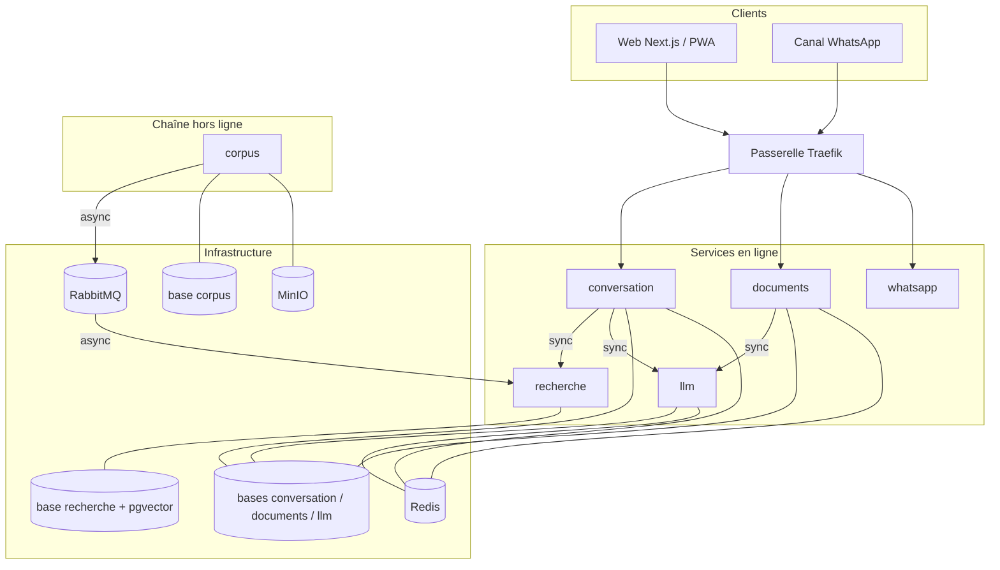
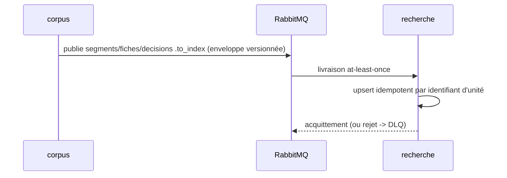

# Architecture cible de la plateforme M3ak

> Document de référence. Les décisions structurantes sont figées dans les
> [ADR](adr/) ; en cas de contradiction, l'ADR fait foi. Contexte général du
> projet : voir `AGENTS.md` à la racine du dépôt.

## 1. Vue d'ensemble

La plateforme sépare deux mondes : une **chaîne documentaire hors ligne**
(batch, lente, fiable, rejouable) qui construit et maintient l'index, et des
**services en ligne** (rapides, sans état critique) qui répondent aux
utilisateurs. Cette séparation est le principe d'évolutivité principal :
on peut refaire toute la chaîne de données sans toucher au produit, et
inversement.

## 2. Les six services

| Service | Responsabilité | Possède (exclusivement) | Exposition |
|---|---|---|---|
| `corpus` | Collecte, normalisation, extraction PDF, segmentation, veille | Stockage brut (MinIO + fichiers), base des documents normalisés et manifestes | Interne |
| `recherche` | Recherche hybride (plein texte AR/FR + vectorielle) et restitution des passages | Base d'index (PostgreSQL + pgvector) | Interne |
| `conversation` | Orchestration des échanges : langue, contexte, construction des réponses sourcées | Base des sessions, messages, signalements | Publique |
| `documents` | Import de documents utilisateurs, OCR, explication, suppression automatique | Zone de stockage éphémère, base des traitements | Publique |
| `llm` | Génération via API Z.ai (GLM), gestion du quota plateforme, file d'attente | Base de consommation (requêtes, jetons, fenêtres de quota) | Interne |
| `whatsapp` | Adaptateur du canal Meta WhatsApp Cloud API | Sans base en V1 | Publique (webhook) |

**Principe database-per-service** : chaque service est l'unique titulaire des
identifiants de sa base ; tout autre accès passe par son API interne
(en-tête `X-Internal-Token`). Il n'existe aucune connexion croisée.

## 3. Flux

### 3.1 Écritures (asynchrones, cohérence finale)

Trois files alimentent l'index, une par famille documentaire :
`segments.to_index` (articles des textes normatifs), `fiches.to_index`
(procédures administratives) et `decisions.to_index` (jurisprudence).
Chaque file a son contrat de message et sa table dédiée côté recherche
(`segments`, `fiches`, `decisions`) : les familles évoluent sans se
toucher.

L'index peut avoir quelques minutes de retard sur le corpus : c'est assumé.
Aucune transaction distribuée n'existe dans la plateforme.

### 3.2 Questions (synchrones)

`client -> Traefik -> conversation` puis, en parallèle ou en séquence :
`conversation -> recherche` (timeout court, ~2 s) pour les passages
pertinents, puis `conversation -> llm` pour la génération (file d'attente
du quota si nécessaire). La réponse porte le correlation ID de bout en bout.

### 3.3 Documents utilisateurs

`client -> Traefik -> documents` : dépôt dans la zone éphémère, tâche OCR,
explication via `llm`, suppression automatique après traitement (traçable).
Ce module n'est activé qu'après autorisation CNDP (commutateur de
fonctionnalité).

## 4. Topologie de déploiement (développement)

Trois réseaux Docker isolés :

- `edge` — Traefik et les services exposés (conversation, documents, whatsapp) ;
- `internal` — services, bases, courtier, cache, stockage objet ;
- `backoffice` — interfaces d'administration (RabbitMQ, console MinIO).

Seuls les ports de Traefik (80, 8080), l'UI RabbitMQ (15672), AMQP (5672)
et la console MinIO (9001) sont publiés, liés à `127.0.0.1`.

## 5. Patterns de résilience

| Pattern | Application |
|---|---|
| Timeout | tout appel inter-services est borné (recherche ~2 s, llm borné par génération) |
| Retry + backoff | uniquement sur opérations idempotentes (une recherche : oui ; une génération facturée : non) |
| Disjoncteur | sur les dépendances critiques (recherche, llm) ; au-delà de N échecs, réponse dégradée |
| Healthcheck | `/health` (vivacité, ouvert) et `/ready` (prêt, protégé) + redémarrage automatique Compose |
| Idempotence | consommation par identifiant d'unité (`segment_id`, `fiche_id`, `decision_id`) ; rejouer un message ne crée jamais de doublon |
| DLQ | chaque file de travail a sa dead-letter queue ; inspection avant rejeu (runbook) |
| Correlation ID | `X-Correlation-ID` généré ou propagé, journalisé par tous les services en JSON |
| Dégradation gracieuse | indisponibilité d'une dépendance = message clair à l'utilisateur, jamais d'erreur brute |

## 6. Sécurité de base

- Jeton de service partagé (`X-Internal-Token`) sur toutes les routes internes ;
  comparaison à temps constant.
- Aucun secret dans le code : tout par variables d'environnement (`infra/.env`,
  non versionné).
- Conteneurs applicatifs non-root ; un utilisateur PostgreSQL par base.
- Interfaces d'administration liées à `127.0.0.1` uniquement.
- Le durcissement OWASP complet est planifié en phase 5 (voir cahier des charges).

## 7. Chemins d'évolution

| Si | Alors |
|---|---|
| Volume vectoriel en millions de segments | Migration Postgres/pgvector -> Qdrant (connexion du seul service recherche) |
| Bascule de fournisseur LLM (ou auto-hébergement) | Interface d'abstraction du service llm ; aucun autre service concerné |
| Montée en charge générale | Duplication des services sans état derrière Traefik, puis Kubernetes |
| Besoin de relecture de flux / débit massif | Réévaluation de Kafka (voir ADR-0002, déclencheurs chiffrés) |
| Application native | La PWA d'abord ; Flutter/React Native si un besoin réel émerge |
